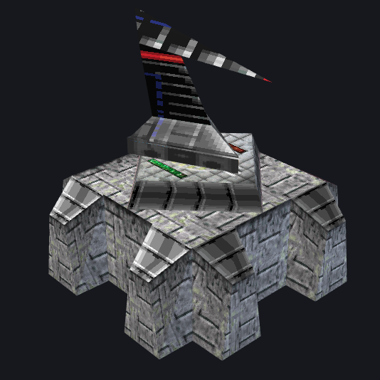
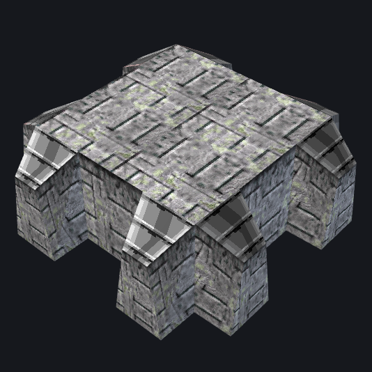
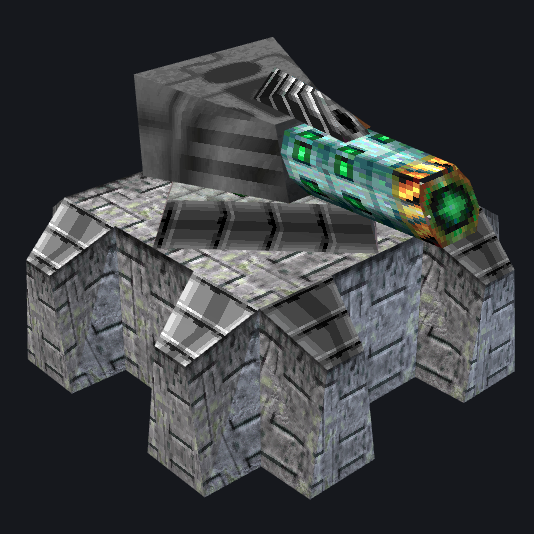
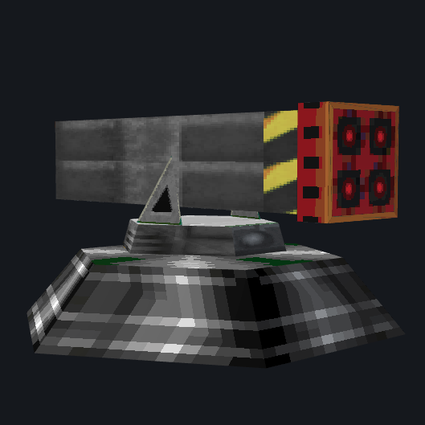

**Warzone 2100 Mod: More Fortress**

Adds 12 new Fortress defenses, 1 large wall, 1 ATGM emplacement, and 1 new tank weapon to skirmish and multiplayer.

## Installation

1. Copy this folder (or its `.wz` pack) into your Warzone 2100 mods folder:
   `mods/<version>/multiplay`
2. Enable the mod when hosting a multiplay or skirmish game.

## New structures

All fortresses join onto walls and come with their own gun. Most are 2x2;
the 3x3 Cannon Fortress is the exception. The Large Wall is a gunless 2x2 block.

Assault Gun Fortress:

- Research "Assault Gun Fortress" after "Assault Gun" (`R-Wpn-MG4`)
  and "Improved Hardcrete Mk3" (`R-Defense-WallUpgrade03`)
- Same range as the Cannon Fortress, less armour
- Can also hit air targets

Flamer Fortress:

- Research "Flamer Fortress" after "Heavy Flamer - Inferno" (`R-Wpn-Flame2`)
  and "Improved Hardcrete Mk3" (`R-Defense-WallUpgrade03`)
- Short-range wall of flame, sets the ground burning

Mortar Fortress:

- Research "Mortar Fortress" after "Mortar" (`R-Wpn-Mortar01Lt`),
  "Improved Hardcrete Mk3" (`R-Defense-WallUpgrade03`)
  and "HE Mortar Shells Mk3" (`R-Wpn-Mortar-Damage03`)
- Entrance-tier indirect fire, 150 damage with 120 splash over 7.5 tiles
- Range 20 tiles, 50% long and 40% short accuracy, same reload as stock Mortar
- 5-tile minimum range, blind to close rushers

Large Rocket Pod Fortress:

- Research "Large Rocket Pod Fortress" after "Mini-Rocket Pod" (`R-Wpn-Rocket05-MiniPod`),
  "Improved Hardcrete Mk3" (`R-Defense-WallUpgrade03`)
  and "HE Rockets Mk3" (`R-Wpn-Rocket-Damage03`)
- 2x2 fortress with 20-round MRP-Super pod, 40 damage per rocket
- Short-range anti-tank saturation, can hit air targets

Wide-Spectrum Sensor Fortress:

- Research "Wide-Spectrum Sensor Fortress" after "Wide Spectrum Sensor"
  (`R-Sys-Sensor-WS`), "Wide Spectrum Sensor Tower" (`R-Sys-Sensor-WSTower`)
  and "Supercrete Mk2" (`R-Defense-WallUpgrade05`)
- Unarmed 2x2 fortress with 1.5x wide-spec sight (3390 range) and 3x mast
- Spots for other fortresses, defenseless alone, limited to 3 per player

Nexus Link Fortress:

- Research "Nexus Link Fortress" after "Nexus Link Turret" (`R-Sys-SpyTurret`)
  and "Supercrete Mk2" (`R-Defense-WallUpgrade05`)
- 2x2 converter fortress, 2.5x turret, 3x beam, 20 damage per hit (10x), 17.5-tile range
- Flips enemy units ten times faster than the stock link turret
- Expensive: 4000 build points, 5000 build power, 15000 RP research, limited to 5 per player

3x3 Cannon Fortress (concept test):

- Research "3x3 Cannon Fortress" after "Plascrete Mk2" (`R-Defense-WallUpgrade08`),
  "HVAPFSDS Cannon Rounds Mk2" (`R-Wpn-Cannon-Damage08`) and "Cannon Autoloader Mk3"
  (`R-Wpn-Cannon-ROF03`)
- 3x3 footprint on a 1.5x fortress body with a doubled cannon
- 760 damage (2x), 640 splash (5 tiles) with 3 s burn, 2816 range (2x), 1.25x fire rate
- 6400 HP and 30 armour (2x stock)

Large Wall:

- Research "Large Wall" after "Supercrete Mk2" (`R-Defense-WallUpgrade05`)
- 2x2 unarmed wall block, 2800 hitpoints (4x hardcrete), no sensor
- Holds the line where a fortress would be overkill

Plasma Cannon Fortress:

- Research "Plasma Cannon Fortress" after "Plasmite Flamer" (`R-Wpn-Plasmite-Flamer`),
  "Plasma Cannon" (`R-Wpn-PlasmaCannon`) and "Supercrete Mk2" (`R-Defense-WallUpgrade05`)
- 2x2 mid-range burst cannon, 2500 damage per shot with 640 splash (5 tiles), 5 s ground burn
- Shreds at 15 tiles, 1.25x stock reload, 2.5x turret with triple-size shells
- 5-tile dead zone, needs screening against rushers

AA Flak Fortress:

- Research "AA Flak Fortress" after "AA Tornado Flak Cannon" (`R-Wpn-AAGun02`)
  and "Supercrete Mk2" (`R-Defense-WallUpgrade05`)
- Anti-air only, very long range with explosive flak shells

ATGM Emplacement:

- Research "ATGM Emplacement" after
  "Anti-Tank Guided Missile Launcher" (`R-Wpn-Rocket-ATGM`)
- Fixed emplacement with the same long-range anti-tank missiles,
  including the 5-tile minimum range

Laser Fortress:

- Research "Laser Fortress" after "Pulse Laser" (`R-Wpn-Laser02`)
  and "Supercrete Mk2" (`R-Defense-WallUpgrade05`)
- Long range, fires a rapid burst of pulses then reloads
- Very good against cyborgs, weak against medium and heavy tanks
- Counter with artillery or a rush of medium tanks

M1299 Howitzer Fortress:

- Research "M1299 Howitzer Fortress" after
  "HEAP Howitzer Shells" (`R-Wpn-Howitzer-Damage04`)
  and "Plascrete Mk2" (`R-Defense-WallUpgrade08`)
- Indirect fire: shells arc over your walls, so it has no line-of-sight requirement
- Range 5 to 80 tiles, best accuracy from 30 to 80 tiles out
- Fires once every 25 seconds, the same cadence as the stock Ground
  Shaker emplacement, hitting about 4 times as hard per shell
- 1400 direct damage and 1400 splash across a 4-tile blast
- Accuracy is 55% at long range and 40% up close, so roughly half of
  shells miss: it is artillery, not a precision gun
- Leaves the ground scorched for 2.5 seconds
- Very heavy turret, turns slowly and rocks back hard on every shot
- Cannot hit anything closer than 5 tiles, so keep your attackers at range
- Countered by fast movers at long range, since the shell arcs slowly
  and lands where the target was

Super RIM-116 AA Fortress:

- Research "Super RIM-116 AA Fortress" after "Avenger SAM" (`R-Wpn-Missile-LtSAM`),
  "Plascrete Mk2" (`R-Defense-WallUpgrade08`), "Search & Destroy Missiles"
  (`R-Wpn-Missile-Accuracy02`), "Advanced Missile Allocation System"
  (`R-Wpn-Missile-ROF01`) and "Sensor Upgrade Mk3" (`R-Sys-Sensor-Upgrade03`)
- Air-only interceptor battery, the hardest hitter in the mod
- Ripples out 60 missiles in about 6 seconds, then sits empty for a
  full minute before it can reload
- Each missile hits for 450 damage, the same as the stock Avenger SAM,
  but it carries 30 times as many rounds: 27000 damage in one salvo
- Range 1 to 32 tiles, with its best accuracy inside 5 tiles
- Accuracy is 75% inside 5 tiles and 65% beyond that
- Survives a lot of punishment at 3200 hitpoints and 15 armour
- Counter with sustained air pressure: once the 60-round belt is empty
  the launcher is defenseless for a minute, and a second fortress can
  out-shoot it on sustained targets

## Research upgrades

Ultra-High Performance Concrete, Carbon-Fibre Reinforced Concrete and
Self-Healing Nano-Concrete:
- Three final wall upgrades, researched in order after "Plasteel Mk3"
  (`R-Defense-WallUpgrade12`), each adding 100% hit points to every wall,
  bunker and fortress on top of the twelve base wall tiers
- Together they add 300%, turning a Laser or RIM-116 Fortress from 3200
  hit points into 24320, and the M1299 Howitzer Fortress from 4000 into
  30400
- Brutally expensive: 65535 research points and 4500 research power each,
  the most expensive research in the game, for 196605 research points and
  13500 research power to get all three
- They add hit points only, so armour still comes from the Plasteel tiers

## New weapon

Anti-Tank Guided Missile Launcher:
- A designable turret for your own tank designs
- Research "Anti-Tank Guided Missile Launcher" after
  "Lancer AT Rocket" (`R-Wpn-Rocket01-LtAT`)
- Very long range anti-tank rockets, best at standoff distance
- Fires a ripple of 4 blue missiles, then waits 20 seconds to reload
- Each missile hits as hard as a stock Lancer, but you get twice as many
  per salvo, so sustained damage is about 1.5 times a Lancer
- Rockets are slow and must be led well ahead of moving targets
- Cannot engage anything inside 5 tiles, so it needs to be well back
- Counter with fast light units that close the distance
