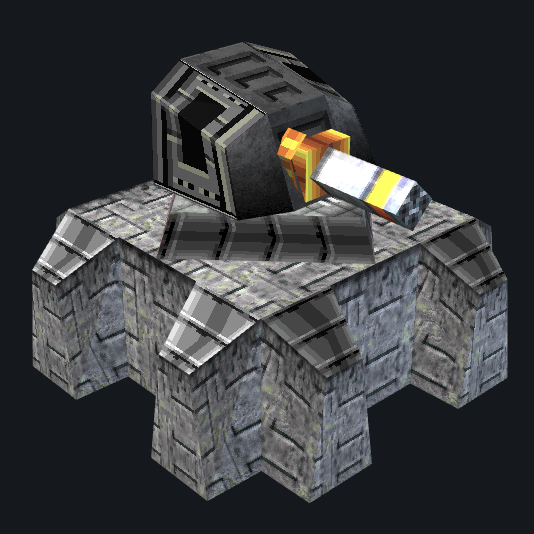
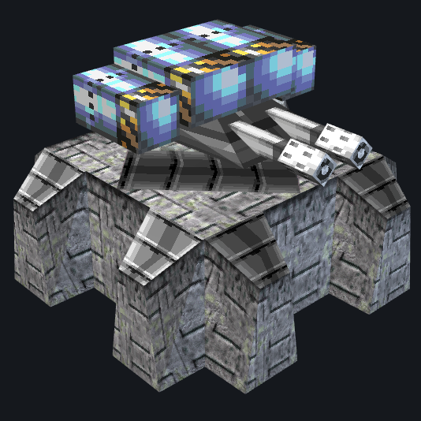
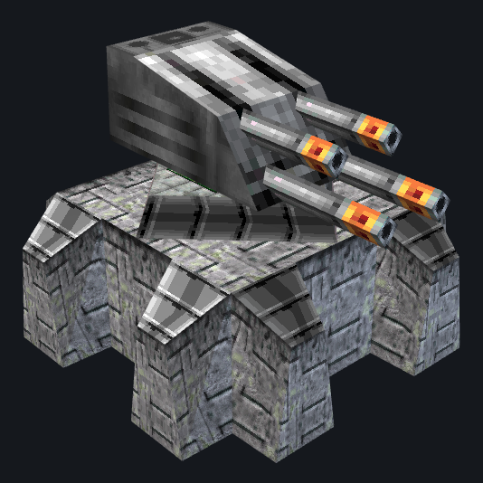
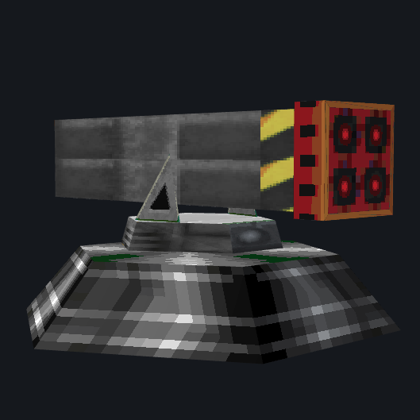
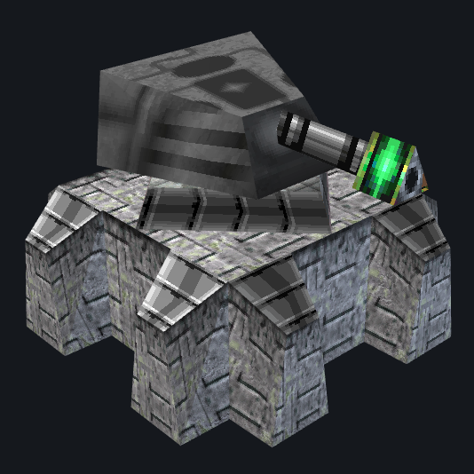
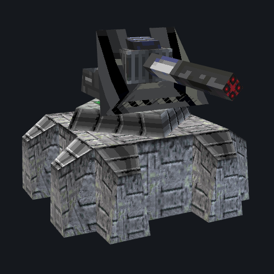
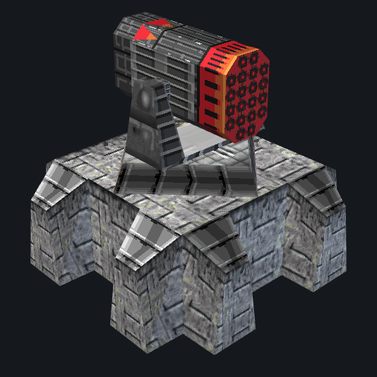

**Warzone 2100 Mod: More Fortress**

Adds 6 new Fortress defenses, 1 ATGM emplacement, and 1 new tank weapon to skirmish and multiplayer.

## Installation

1. Copy this folder (or its `.wz` pack) into your Warzone 2100 mods folder:
   `mods/<version>/multiplay`
2. Enable the mod when hosting a multiplay or skirmish game.

## New structures

All fortresses are 2x2, join onto walls, and come with their own long-range gun.

Assault Gun Fortress:

- Research "Assault Gun Fortress" after "Assault Gun" (`R-Wpn-MG4`)
  and "Improved Hardcrete Mk3" (`R-Defense-WallUpgrade03`)
- Same range as the Cannon Fortress, less armour
- Can also hit air targets

Flamer Fortress:

- Research "Flamer Fortress" after "Heavy Flamer - Inferno" (`R-Wpn-Flame2`)
  and "Improved Hardcrete Mk3" (`R-Defense-WallUpgrade03`)
- Short-range wall of flame, sets the ground burning

AA Flak Fortress:

- Research "AA Flak Fortress" after "AA Tornado Flak Cannon" (`R-Wpn-AAGun02`)
  and "Supercrete Mk2" (`R-Defense-WallUpgrade05`)
- Anti-air only, very long range with explosive flak shells

ATGM Emplacement:

- Research "ATGM Emplacement" after
  "Anti-Tank Guided Missile Launcher" (`R-Wpn-Rocket-ATGM`)
- Fixed emplacement with the same long-range anti-tank missiles,
  including the 5-tile minimum range

Laser Fortress:

- Research "Laser Fortress" after "Pulse Laser" (`R-Wpn-Laser02`)
  and "Supercrete Mk2" (`R-Defense-WallUpgrade05`)
- Long range, fires a rapid burst of pulses then reloads
- Very good against cyborgs, weak against medium and heavy tanks
- Counter with artillery or a rush of medium tanks

M1299 Howitzer Fortress:

- Research "M1299 Howitzer Fortress" after
  "Heavy Howitzer - Ground Shaker" (`R-Wpn-HvyHowitzer`)
  and "Supercrete Mk2" (`R-Defense-WallUpgrade05`)
- Indirect fire: shells arc over your walls, so it has no line-of-sight requirement
- Range 5 to 80 tiles, best accuracy from 30 to 80 tiles out
- Fires once every 25 seconds, the same cadence as the stock Ground
  Shaker emplacement, hitting about 4 times as hard per shell
- 1400 direct damage and 1400 splash across a 4-tile blast
- Accuracy is 55% at long range and 40% up close, so roughly half of
  shells miss: it is artillery, not a precision gun
- Leaves the ground scorched for 2.5 seconds
- Very heavy turret, turns slowly and rocks back hard on every shot
- Cannot hit anything closer than 5 tiles, so keep your attackers at range
- Countered by fast movers at long range, since the shell arcs slowly
  and lands where the target was

Super RIM-116 AA Fortress:

- Research "Super RIM-116 AA Fortress" after "Avenger SAM"
  (`R-Wpn-Missile-LtSAM`), "Supercrete Mk2" (`R-Defense-WallUpgrade05`)
  and "Fortress Sensor Upgrade" (`R-Sys-Sensor-FortressUpgrade`)
- Air-only interceptor battery, the hardest hitter in the mod
- Ripples out 60 missiles in about 6 seconds, then sits empty for a
  full minute before it can reload
- Each missile hits for 450 damage, the same as the stock Avenger SAM,
  but it carries 30 times as many rounds: 27000 damage in one salvo
- Range 1 to 32 tiles, with its best accuracy inside 5 tiles
- Accuracy is 75% inside 5 tiles and 65% beyond that
- Survives a lot of punishment at 3200 hitpoints and 15 armour
- Counter with sustained air pressure: once the 60-round belt is empty
  the launcher is defenseless for a minute, and a second fortress can
  out-shoot it on sustained targets

## Research upgrades

Fortress Sensor Upgrade:
- Research "Fortress Sensor Upgrade" after "Sensor Upgrade Mk3"
  (`R-Sys-Sensor-Upgrade03`)
- Raises the detection range of every fortress's built-in sensor from
  12 tiles to 18 tiles, matching the Wide Spectrum Sensor
- Affects only fortresses that use the Fortress Sensor, so your other
  buildings keep their normal sight
- Also required before the Super RIM-116 AA Fortress can be researched

Ultra-High Performance Concrete:
- Research "Ultra-High Performance Concrete" after "Plasteel Mk3"
  (`R-Defense-WallUpgrade12`)
- A final wall upgrade that adds 300% hit points to every wall, bunker
  and fortress in the game, on top of the twelve base wall tiers
- Brutally expensive: 192000 research points and 4500 research power,
  almost four times the cost of the priciest stock research
- Turns a Laser or RIM-116 Fortress from 3200 hit points into 24320,
  and the M1299 Howitzer Fortress from 4000 into 30400
- It adds hit points only, so armour still comes from the Plasteel tiers

## New weapon

Anti-Tank Guided Missile Launcher:
- A designable turret for your own tank designs
- Research "Anti-Tank Guided Missile Launcher" after
  "Lancer AT Rocket" (`R-Wpn-Rocket01-LtAT`)
- Very long range anti-tank rockets, best at standoff distance
- Fires a ripple of 4 blue missiles, then waits 20 seconds to reload
- Each missile hits as hard as a stock Lancer, but you get twice as many
  per salvo, so sustained damage is about 1.5 times a Lancer
- Rockets are slow and must be led well ahead of moving targets
- Cannot engage anything inside 5 tiles, so it needs to be well back
- Counter with fast light units that close the distance
